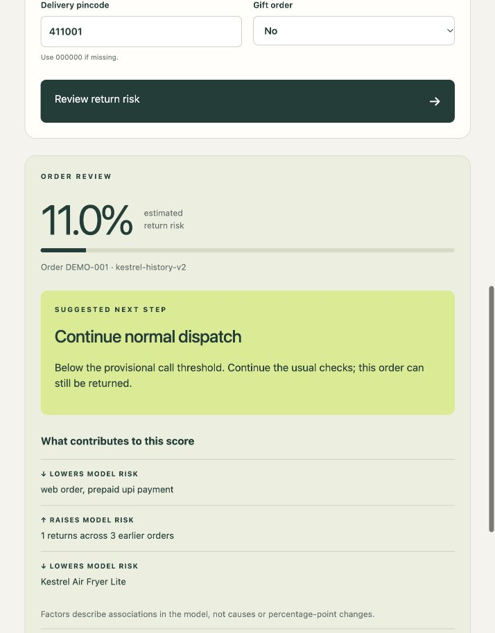

# Kestrel Returns Risk

A reproducible, local-first returns-risk application for pre-dispatch order review. It combines a transparent logistic regression model, a JSON prediction endpoint, an operations interface and a cost-based confirmation-call policy.

**Python 3.10+ · Zero runtime dependencies · No paid API key · Private engagement**

> This is an evaluated pilot, not an automated dispatch controller. It never holds orders or places calls. The evidence does not support a 95% accuracy claim. Review the model limitations before using scores operationally.

## Quick start

```sh
git clone https://github.com/Kartik-loop/kestrel-returns-risk.git
cd kestrel-returns-risk
python3 src/server.py
```

Open **http://127.0.0.1:8000**. No training dataset or package installation is needed to run the bundled model. Use `--port 8080` if the default port is occupied.

## What is included

- A browser interface for single-order risk review and readable model factors.
- A validated JSON endpoint using the same model as batch predictions.
- Root-level `predictions.csv` with 2,096 records in the supplied template order.
- Reproducible preparation, chronological evaluation and economics scripts.
- Eleven automated service tests, a decision memo and transparent AI disclosure.

## Results at a glance

| Measure | Result | Interpretation |
|---|---:|---|
| Distinct historical orders | 10,504 | After reconciling 651 duplicate imports |
| Historical returns | 1,200 (11.42%) | Predicting no return alone has high accuracy |
| Development ROC AUC | 0.7664 | Four chronological evaluation windows |
| Development log loss | 0.31175 | Counts-only history representation |
| Exposed diagnostic ROC AUC | 0.7552 | Not a fresh independent holdout |
| Submission predictions | 2,096 | Exact IDs and ordering validated |

The Rs 30,545 targeted-call savings figure in the memo is a **conditional retrospective scenario**, not observed intervention savings. It assumes 35% prevention and excludes unsupported inputs. See [the current summary](SUMMARY.md), [memo](MEMO.md) and [revision evidence](reports/HISTORY_REVISION.md).

## Architecture

```text
Browser form → POST /api/predict → input validation → feature preparation
                                                  ↓
                                  frozen logistic model + policy
                                                  ↓
                             score, reasons, warnings, recommendation
```

The runtime uses Python's standard library; optional research dependencies are pinned separately. The model artifact contains parameters and catalog metadata, not raw customer records. Original customer/order datasets and local environments are excluded.

## Repository guide

| Path | Purpose |
|---|---|
| `src/server.py`, `src/scoring.py` | HTTP service and portable inference |
| `web/` | Interface, styling and endpoint integration |
| `assets/model.json` | Frozen serving model and catalog |
| `predictions.csv` | Required submission output |
| `tests/` | Input, policy, leakage and endpoint tests |
| `reports/` | Audit, experiment results, economics and release hashes |
| `MEMO.md` | Business recommendation for Ritu |
| `AI_DISCLOSURE.md` | Tools used, cost limits and discarded approaches |
| `RECORDING_SCRIPT.md` | Three-minute demo guide; video still required |
| `SUBMISSION_NOTES.md` | Expected-score rationale and remaining form tasks |

<details><summary>Interface preview — invented sample order</summary>



</details>

## Run the working service

Python 3.10+ is required. No extra packages, paid API key, original data pack or network connection is needed for the demo.

From this repository root:

```sh
python3 src/server.py
```

Open http://127.0.0.1:8000. Windows users may use `py -3 src/server.py`. If occupied, run `python3 src/server.py --port 8080` and open that port. Stop with Ctrl+C. Keep assets/model.json with the code. This local demo binds to 127.0.0.1; it is not a production web server. Requests are not stored or uploaded. A missing model produces a clear unavailable-model message while the screen still loads.

## Try it

Reset to the invented sample and review it: about 11.0% risk. Change earlier returns to three (earlier orders remain three): about 46.8%. More than ten earlier orders yields manual review. Other valid inputs outside training ranges yield a visibly provisional estimate and no rupee savings estimate. Invalid records are rejected. No action is executed.

The above-ten review rule is a requested operational preference, not a proven accuracy cutoff. Training data contains at most nine earlier orders and quantities one or two. The model's ability to calculate a number outside this experience does not establish that number's accuracy.

## Endpoint

POST /api/predict with Content-Type: application/json and one order:

```json
{"order_id":"DEMO-001","order_placed_at":"2026-09-15 10:30","sku":"KH-AF-01","sales_channel":"web","payment_mode":"prepaid_upi","discount_pct":10,"qty":1,"order_value_inr":4679.10,"promised_delivery_days":5,"delivery_pincode":"411001","is_gift":"N","customer_prior_orders":3,"customer_prior_returns":1}
```

All fields shown are required. Dates are IST; pincode must be a six-digit string. Extra fields, including outcomes, notes and pickup/service events, are ignored. Amount must reconcile with the catalog, quantity and discount; the documented October 2025 unit correction is applied when verified. Supported catalog choices: GET /api/catalog. Readiness: GET /api/health.

Response includes score, recommendation, model version, reasons, warnings and action_executed=false. Score and economics are null for the above-ten manual-review case. Extrapolated scores are labelled provisional and financial estimates remain null. For supported inputs, the call threshold is 45/(0.35×1150); this is a scenario assumption, not measured intervention benefit. A negative expected savings value means modeled call benefit is below its cost.

HTTP errors: 400 malformed JSON; 403 foreign origin; 413 oversized/missing body; 415 wrong content type; 422 invalid order; 503 unavailable model.

## Tests

```sh
python3 -m unittest discover -s tests -v
```

Requires permission to open a local socket. No dependencies or source data needed. Eleven tests cover input errors, ignored leakage fields, numerical behavior, quantities, the ten/eleven-order boundary, both recommendation paths and HTTP routes.

## Read the evidence

Start with SUMMARY.md and MEMO.md. reports/release_manifest.json freezes model/prediction hashes. reports/history_revision_results.json holds v2 development and diagnostic results. reports/HISTORY_REVISION.md, EVALUATION.md and POLICY.md preserve the development history; older range-guard behavior and v1 figures are historical and superseded by this README and SUMMARY.md. Reports/abstention_checks.json records a previous stricter guard, not current deployment behavior.

## Reproduce analysis (optional)

Serving needs only standard Python. Analysis requires the pinned requirements.txt (developed with Python 3.13.5). In a virtual environment:

```sh
python -m pip install -r requirements.txt
python src/prepare.py --input-dir /path/to/original-pack
python src/revise_history.py
python src/economics.py --input-dir /path/to/original-pack
python src/predict_batch.py --input /path/to/test_unlabelled.csv --template /path/to/sample_submission.csv
```

Use actual UUID-prefixed filenames if present. The original pack is deliberately excluded from this archive. prepare.py preserves inputs. revise_history.py recreates v2 and exports its JSON; archived reports/v1/model.json supplies catalog metadata. train.py and export_model.py recreate v1 and are retained for historical reproducibility, not the current release. Do not run with Python -O because audit assertions must remain active. Never load an untrusted pickle/joblib file.

## Files and submission status

predictions.csv is at repository root and must be committed. The model is frozen; no production refit is implied. MEMO.md is the concise memo, RECORDING_SCRIPT.md is a guide (not a video), and SUBMISSION_NOTES.md contains expected-score rationale and remaining form tasks. AI_DISCLOSURE.md explains assistance and costs.

Do not publish customer data, this engagement's catalog/model or outputs publicly. Use a private repository with authorized evaluator access. Repository publication is tracked separately; the external form and actual video remain outstanding. Review the remaining items in SUBMISSION_NOTES.md.
